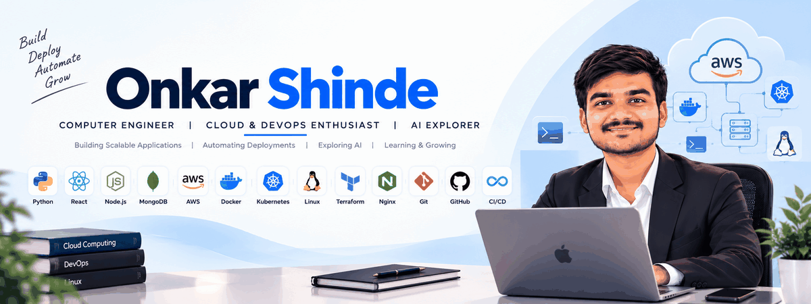
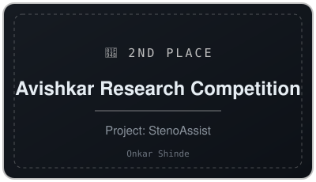
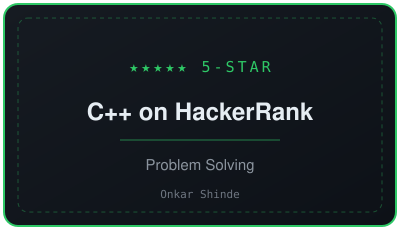
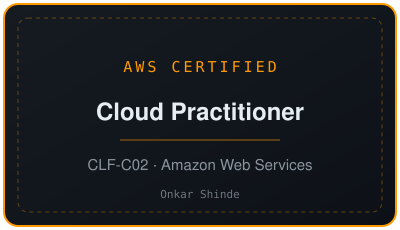
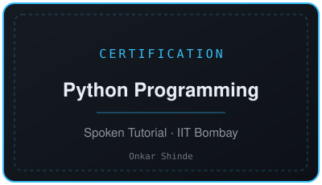

<!-- ===================== HEADER ===================== -->

  

<h3 align="center"><code>&gt; Hey There!, I am <a href="https://www.linkedin.com/in/onkar-shinde16/">Onkar Shinde</a></code></h3>

  <code>「 Computer Engineer · Cloud &amp; DevOps Enthusiast · AI Explorer · AWS Certified Cloud Practitioner 」</code>

  

  

  
  
  
  

  

<!-- ===================== CORE PANEL ===================== -->

  

  

## 👨‍💻 About Me

Computer Engineering graduate from **Sinhgad Academy of Engineering, Savitribai Phule Pune University** (CGPA **8.17/10**) with strong foundations in computer science, cloud computing and full-stack web development.

- ☁️ **AWS Certified Cloud Practitioner** — experienced in designing and deploying scalable, secure cloud infrastructure
- 🤖 Passionate about **Artificial Intelligence, Large Language Models and Computer Vision**
- ⚙️ **Cloud &amp; DevOps enthusiast** — containerising with **Docker**, orchestrating with **Kubernetes**, provisioning with **Terraform** and automating deployments with **CI/CD**
- 🌐 Build full-stack apps with **Python, Flask, React, Node.js, SQL and MongoDB**
- 🎯 Goal: build secure, real-world software that creates meaningful impact
- 📫 Reach me at **onkarshinde1609@gmail.com**

  

# 🛠 Technologies, Projects, and Domains

<h2>🛠 Technologies</h2>

<table align="center">
  <tr>
    <td align="center" width="96"> Python</td>
    <td align="center" width="96"> C++</td>
    <td align="center" width="96"> JavaScript</td>
    <td align="center" width="96"> HTML</td>
    <td align="center" width="96"> CSS</td>
  </tr>
  <tr>
    <td align="center" width="96"> Flask</td>
    <td align="center" width="96"> React.js</td>
    <td align="center" width="96"> Bootstrap</td>
    <td align="center" width="96"> SQLite</td>
    <td align="center" width="96"> AWS</td>
  </tr>
  <tr>
    <td align="center" width="96"> PyTorch</td>
    <td align="center" width="96"> OpenCV</td>
    <td align="center" width="96"> Hugging Face</td>
    <td align="center" width="96"> Git</td>
    <td align="center" width="96"> Linux</td>
  </tr>
  <tr>
    <td align="center" width="96"> VS Code</td>
    <td align="center" width="96"> GitHub</td>
    <td align="center" width="96"> Jupyter</td>
    <td align="center" width="96"> SQL</td>
    <td align="center" width="96"> WhatsApp API</td>
  </tr>
  <tr>
    <td align="center" width="96"> Node.js</td>
    <td align="center" width="96"> MongoDB</td>
    <td align="center" width="96"> Docker</td>
    <td align="center" width="96"> Kubernetes</td>
    <td align="center" width="96"> Terraform</td>
  </tr>
  <tr>
    <td align="center" width="96"> Nginx</td>
    <td align="center" width="96"> GitHub Actions</td>
    <td align="center" width="96"> Jenkins</td>
    <td align="center" width="96"> Bash</td>
    <td align="center" width="96"> YAML</td>
  </tr>
</table>

**Core Concepts:** Data Structures & Algorithms · Object-Oriented Programming · REST APIs · Computer Networks · Operating Systems

<h2>🧪 Projects</h2>

| Project | Stack | Highlights |
|---|---|---|
| 🧠 **[StenoAssist – Legal Sentence Suggestion System](https://github.com/OnkarS1216/StenoAssist-Smart-Legal-Sentence-Suggestion-System-using-LLMs)** | Python · PyTorch · OpenCV · Flask · React · LLMs | End-to-end AI pipeline (OpenCV segmentation → EfficientNet-B0 CNN → LLM correction) that turns scanned shorthand into legal text. Trained on **750,000+** augmented samples from a **15,000-symbol** dataset. **95%+** LLM correction accuracy with **sub-3-second** CPU inference. JWT auth + PDF export. 🥈 *2nd place, Avishkar* |
| ☁️ **[Production-Ready AWS VPC Architecture](https://github.com/OnkarS1216/aws-vpc-production-architecture)** | AWS EC2 · VPC · ALB · Auto Scaling · NAT Gateway · IAM | Secure, highly available infrastructure with public & private subnets, Auto Scaling Groups behind an Application Load Balancer, NAT Gateway and least-privilege IAM / Security Groups. |
| 💬 **[WhatsApp Task Management System](https://github.com/OnkarS1216/whatsapp-task-manager)** | Python · Flask · SQLite · WhatsApp API | Flask backend for task automation and real-time message processing; WhatsApp commands generate automated responses; secure SQLite dashboard for task tracking and user management. |

<h2>🧠 Domains</h2>

- ☁️ **Cloud Computing** — AWS networking, high availability, scalability, cloud security
- 🤖 **AI / ML** — Deep learning, OCR, computer vision, Large Language Models
- ⚙️ **DevOps** — Docker, Kubernetes, Terraform (IaC), Nginx, CI/CD pipelines, Linux
- 🌐 **Full-Stack Development** — Flask / React / Node.js apps, REST APIs, MongoDB &amp; SQL, authentication
- ⚙️ **Automation** — chat-driven workflows and backend automation

  

## 🎓 Education

| Institution | Qualification | Year | Score |
|---|---|---|---|
| **Sinhgad Academy of Engineering**, SPPU, Pune | B.E. Computer Science & Engineering | 2022 – 2026 | **CGPA 8.17 / 10** |
| **Vivekanand Arts, Sardar Dalipsing Commerce & Science College**, Chhatrapati Sambhajinagar | Higher Secondary (12th) – MSBSHSE | 2022 | 76.50% |
| **Swami Vivekanand Academy**, Chhatrapati Sambhajinagar | Secondary (10th) – MSBSHSE | 2020 | 93.40% |

<!-- ===================== CERTIFICATIONS (DIMFLIX-style) ===================== -->
## 🏆 Prize places and achievements

  
  

## ⚜️ Significant certificates

  
  

  

### 📊 Vital Statistics

  

  

  
  

  

  

<table width="100%">
<tr>
<td width="50%" valign="top">

### 🤝 Collaboration

I'm open to collaborating on:

- Cloud architecture, DevOps &amp; CI/CD automation projects
- AI / LLM-powered applications
- Computer vision & OCR systems
- Full-stack web applications

</td>
<td width="50%" valign="top">

### 📫 Contact

 
 

</td>
</tr>
</table>

  

  ⚡ <i>Build · Deploy · Automate · Grow — secure, scalable cloud systems and AI-powered software</i> 
  Star ⭐ the repos if they helped you!

  

